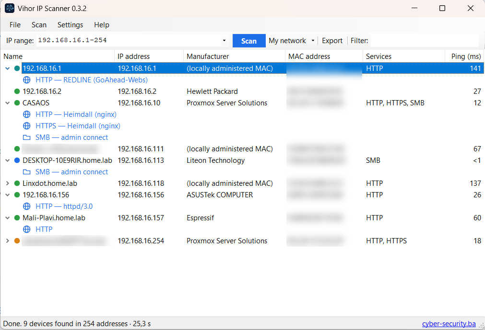

<p align="center">
  
</p>

<h1 align="center">Vihor IP Scanner</h1>

<p align="center">
  Fast, free &amp; open-source network scanner for Windows — by <a href="https://cyber-security.ba">cyber-security.ba</a>
</p>

<p align="center">
  <a href="https://github.com/freedole/vihor-ip-scanner/releases/latest"></a>
  <a href="https://github.com/freedole/vihor-ip-scanner/actions/workflows/build.yml"></a>
  <a href="LICENSE"></a>
</p>

<p align="center">
  <a href="https://apps.microsoft.com/detail/9NHGBPBZZLCN"></a>
  &nbsp;
  <a href="https://alternativeto.net/software/vihor-ip-scanner/about/?utm_source=badge&utm_medium=referral"></a>
</p>

<p align="center">
  
</p>

> **Vihor** /ˈviː.hɔr/ — Slavic for *whirlwind*. Made in Bosnia and Herzegovina.

## Features

- **Fast discovery** — parallel ICMP ping + ARP, so devices that block ping are found too
- **Device details** — name (DNS / NetBIOS), IP, MAC address, manufacturer (offline IEEE OUI database), ping time
- **Service detection** — HTTP/HTTPS (incl. 8080, 8443, Proxmox 8006) with page title and server, SSH/FTP/VNC banners, SMB, RDP, Telnet, printers (9100)
- **Expandable rows** — click the arrow next to a device to list its services; double-click a service to open it
- **One-click actions** — Remote Desktop, SSH, open in browser, shared folders (`\\IP`), FTP, ping, traceroute
- **Wake-on-LAN** and remote shutdown / restart (with confirmation)
- **Copy** IP, name, MAC, manufacturer or whole rows · **Export** to CSV (Excel-friendly) and HTML
- **Flexible ranges** — `192.168.1.1-254`, `192.168.1.0/24`, `10.0.0.1-10.0.3.254`, comma-separated lists
- **Languages** — English, Srpski, Hrvatski, Bosanski (installer in 40+ languages)
- **Options** — scanning speed from fast to thorough, choose which services to detect, add your own TCP ports
- **Scan comparison** — new devices since the last scan are highlighted, missing ones are listed in grey
- **Dark theme** — follows Windows or can be set manually
- **Lightweight** — ~1 MB, no admin rights needed to run, no telemetry, no ads, no internet connection required

## Download

- **Microsoft Store** (recommended, no SmartScreen warning): [Vihor IP Scanner](https://apps.microsoft.com/detail/9NHGBPBZZLCN)
- **Installer or portable ZIP:** [latest release](https://github.com/freedole/vihor-ip-scanner/releases/latest) — also mirrored on [SourceForge](https://sourceforge.net/projects/vihor-ip-scanner/)

Every release lists SHA-256 checksums in `SHA256SUMS.txt`.

**Scoop:**

```powershell
scoop bucket add vihor https://github.com/freedole/vihor-ip-scanner
scoop install vihor
```

**Requirements:** Windows 10 / 11 (or Windows 7 SP1+ with .NET Framework 4.8).

> Until code signing is in place, the installer and ZIP from GitHub/SourceForge may trigger Windows SmartScreen: *"Windows protected your PC"*.
> Click **More info → Run anyway**. You can verify the file against the published SHA-256 checksum and review the source code here.

## Command line

For scheduled inventories (Task Scheduler), Vihor can scan without a window:

```
VihorIPScanner.exe /scan 192.168.1.1-254 /export C:\Reports\lan.csv [/speed 1-5] [/ranges]
```

The export (CSV or HTML, by file extension) includes notes and a Status column with devices that are new or missing since the previous scan of the same range.

## Keyboard shortcuts

| Key | Action |
|---|---|
| `F5` | Start / stop scan |
| `Esc` | Stop scan |
| `Enter` / double-click | Default action (RDP → HTTPS → HTTP → shared folders → SSH → ping) |
| `Ctrl+C` | Copy selected IP addresses |
| `Ctrl+F` | Filter results |

## Building from source

```powershell
dotnet build src/Vihor/Vihor.csproj -c Release
iscc /DAppVersion=0.1.0 installer\vihor.iss     # optional: installer (Inno Setup 6.5+)
```

Releases are built by GitHub Actions from tagged commits (`v*`). Nothing is built on a developer machine.

## Translations

UI strings live in [`src/Vihor/Lang`](src/Vihor/Lang) as simple `key=value` files.
To add a language, copy `en.lang` to `<iso-code>.lang` (e.g. `de.lang`), translate the values and open a pull request.

## Code signing policy

Code signing for Windows release builds has been requested from the [SignPath Foundation](https://signpath.org)
(free code signing for open-source projects). Until approved, release binaries are unsigned.

- All release binaries are built by GitHub Actions from the public source code in this repository; nothing built on a personal machine is published.
- Every signing request is approved manually by an approver.
- The product name and version in the file metadata match this project and its release tag.

Team roles:

| Role | Members |
|---|---|
| Committers (authors) | [Đorđe Kaurinović](https://github.com/freedole) |
| Reviewers | [Đorđe Kaurinović](https://github.com/freedole) |
| Approvers | [Đorđe Kaurinović](https://github.com/freedole) |

## Privacy policy

This program will not transfer any information to other networked systems unless specifically requested by the user or the person installing or operating it.

It only contacts the IP addresses the user chooses to scan, and opens web pages (cyber-security.ba, GitHub) only when the user clicks the corresponding menu item. There is no telemetry, no update check and no analytics.

## License

[MIT](LICENSE) © 2026 Đorđe Kaurinović · [cyber-security.ba](https://cyber-security.ba)

MAC vendor data © IEEE Registration Authority.
