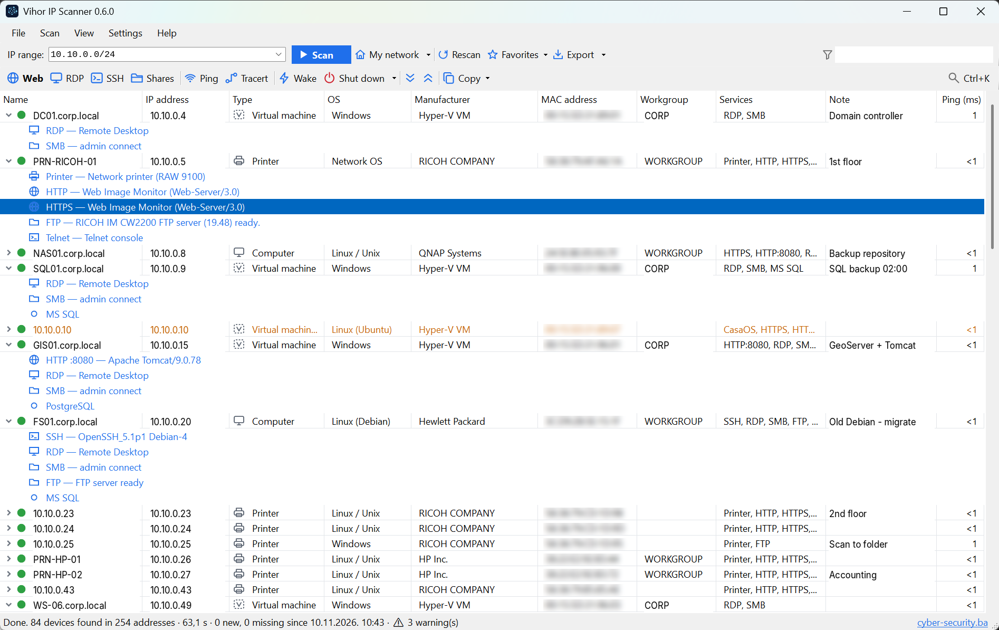

<p align="center">
  
</p>

<h1 align="center">Vihor IP Scanner</h1>

<p align="center">
  Fast, free &amp; open-source network scanner for Windows - by <a href="https://cyber-security.ba">cyber-security.ba</a>
</p>

<p align="center">
  <a href="https://github.com/freedole/vihor-ip-scanner/releases/latest"></a>
  <a href="https://github.com/freedole/vihor-ip-scanner/actions/workflows/build.yml"></a>
  <a href="LICENSE"></a>
</p>

<p align="center">
  <a href="https://apps.microsoft.com/detail/9NHGBPBZZLCN"></a>
  &nbsp;
  <a href="https://alternativeto.net/software/vihor-ip-scanner/about/?utm_source=badge&utm_medium=referral"></a>
</p>

<p align="center">
  
</p>

> **Vihor** /ˈviː.hɔr/ - Slavic for *whirlwind*. Made in Bosnia and Herzegovina.

## Features

**Discovery**
- **Fast** - parallel ICMP ping + ARP, so devices that block ping are found too
- **Device details** - name (DNS / NetBIOS, with source), IP, MAC, manufacturer (offline IEEE OUI database), ping time
- **Device type and OS** - this PC, gateway, router / firewall, hypervisor, virtual machine, NAS, server, computer, printer, camera, phone, IoT; OS from known systems, SSH banner and TTL
- **Virtual machines named** - Proxmox, Hyper-V, VMware, VirtualBox, QEMU/KVM, Xen and Docker network cards are recognised by MAC prefix

**Services**
- **Admin systems out of the box** - Proxmox VE / Backup, Portainer, TrueNAS, Synology, QNAP, Unraid, OpenMediaVault, OPNsense, pfSense, UniFi, Omada, MikroTik, ESXi / vCenter, iDRAC, iLO, Grafana, Zabbix, Home Assistant, Pi-hole and more
- **Web, SSH, RDP, SMB, FTP, VNC, Telnet, printers (9100), IP cameras (RTSP)**, databases (MS SQL, MySQL, PostgreSQL) - with page titles, server headers and banners
- **HTTPS certificates** - issuer and expiry date

**Warnings** (orange ⚠, filter with `⚠`)
- the same MAC on two IPs, a possible IP conflict (ARP and NetBIOS disagree), HTTPS certificates that expire within 30 days

**Tools**
- **Toolbar for the selected device** - Web, RDP, SSH, shares, ping, traceroute, Wake-on-LAN, shut down / restart
- **Built-in ping and traceroute** windows with loss and min / avg / max
- **Double-click / Enter** opens what the device offers: admin panel, RDP, web page, SSH or shares
- **Ctrl+K command palette**, **favorites** (saved ranges and devices), **notes** per device
- **Scan comparison** - new devices highlighted, missing ones listed in grey
- **Export** to CSV (Excel-friendly), HTML and JSON · **command line** for scheduled inventories

**Comfort**
- Columns can be shown / hidden and reordered (right-click the header); widths are remembered
- Dark theme (follows Windows), icons-only toolbar, English, Srpski, Hrvatski, Bosanski
- **Lightweight** - ~1 MB, no admin rights needed, no telemetry, no ads

## Download

- **Microsoft Store** (recommended, no SmartScreen warning): [Vihor IP Scanner](https://apps.microsoft.com/detail/9NHGBPBZZLCN)
- **Installer or portable ZIP:** [latest release](https://github.com/freedole/vihor-ip-scanner/releases/latest) - also mirrored on [SourceForge](https://sourceforge.net/projects/vihor-ip-scanner/)

Every release lists SHA-256 checksums in `SHA256SUMS.txt`.

**Scoop:**

```powershell
scoop bucket add vihor https://github.com/freedole/vihor-ip-scanner
scoop install vihor
```

**Requirements:** Windows 10 / 11 (or Windows 7 SP1+ with .NET Framework 4.8).

> Until code signing is in place, the installer and ZIP from GitHub/SourceForge may trigger Windows SmartScreen: *"Windows protected your PC"*.
> Click **More info → Run anyway**. You can verify the file against the published SHA-256 checksum and review the source code here.

## Command line

For scheduled inventories (Task Scheduler), Vihor can scan without a window:

```
vihor /scan 192.168.1.1-254 /export C:\Reports\lan.csv
```

The `vihor` command is available in any console after installing from the Microsoft Store, with Scoop, or with the installer (option *Add Vihor to PATH*, on by default). With the portable ZIP, use the full path to `VihorIPScanner.exe`.

| Option | Meaning |
|---|---|
| `/scan <range>` | IP range, e.g. `192.168.1.1-254` or `10.0.0.0/24` |
| `/export <file>` | save the result as CSV, HTML or JSON (by file extension) |
| `/speed 1-5` | 1 = fastest … 5 = most thorough (default: as in Options) |
| `/ranges` | also check the port ranges from Options |
| `/?` | help |

Notes:

- The folder for the export must exist (e.g. `mkdir C:\Reports`).
- The export includes notes and a Status column with devices that are new or missing since the previous scan of the same range.

## Keyboard shortcuts

| Key | Action |
|---|---|
| `F5` | Start / stop scan |
| `Esc` | Stop scan |
| `Enter` / double-click | Open the device: admin panel → RDP → web → SSH → shares → ping (on a service row: that service) |
| `Ctrl+K` | All commands, device actions and favorites |
| `Ctrl+R` | Rescan selected devices |
| `Ctrl+C` / `Ctrl+Shift+C` | Copy selected IP addresses / whole rows |
| `Ctrl+F` | Filter results |
| `Ctrl++` / `Ctrl+-` | Expand / collapse all |
| `→` / `←` | Expand / collapse the selected device |

## Building from source

```powershell
dotnet build src/Vihor/Vihor.csproj -c Release
iscc /DAppVersion=0.1.0 installer\vihor.iss     # optional: installer (Inno Setup 6.5+)
```

Releases are built by GitHub Actions from tagged commits (`v*`). Nothing is built on a developer machine.

## Translations

UI strings live in [`src/Vihor/Lang`](src/Vihor/Lang) as simple `key=value` files.
To add a language, copy `en.lang` to `<iso-code>.lang` (e.g. `de.lang`), translate the values and open a pull request.

## Code signing policy

Code signing for Windows release builds has been requested from the [SignPath Foundation](https://signpath.org)
(free code signing for open-source projects). Until approved, release binaries are unsigned.

- All release binaries are built by GitHub Actions from the public source code in this repository; nothing built on a personal machine is published.
- Every signing request is approved manually by an approver.
- The product name and version in the file metadata match this project and its release tag.

Team roles:

| Role | Members |
|---|---|
| Committers (authors) | [Đorđe Kaurinović](https://github.com/freedole) |
| Reviewers | [Đorđe Kaurinović](https://github.com/freedole) |
| Approvers | [Đorđe Kaurinović](https://github.com/freedole) |

## Privacy policy

This program will not transfer any information to other networked systems unless specifically requested by the user or the person installing or operating it.

It only contacts the IP addresses the user chooses to scan, and opens web pages (cyber-security.ba, GitHub) only when the user clicks the corresponding menu item. There is no telemetry and no analytics.

The installer and portable versions ask the public GitHub API at most once a day whether a newer release exists (`api.github.com/repos/freedole/vihor-ip-scanner/releases/latest`). Nothing about the user, the computer or the scan is sent, and nothing is downloaded automatically. The Microsoft Store version does not do this, because the Store handles updates. To turn the check off, set `CheckUpdates=0` in `%APPDATA%\Vihor\settings.ini`.

## License

[MIT](LICENSE) © 2026 Đorđe Kaurinović · [cyber-security.ba](https://cyber-security.ba)

MAC vendor data © IEEE Registration Authority.
